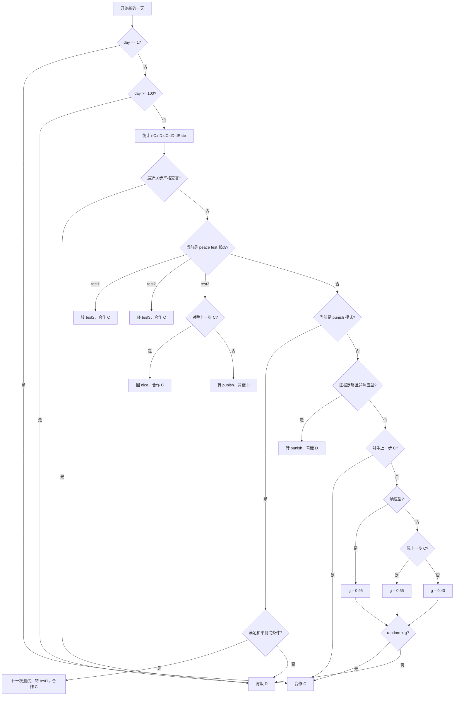
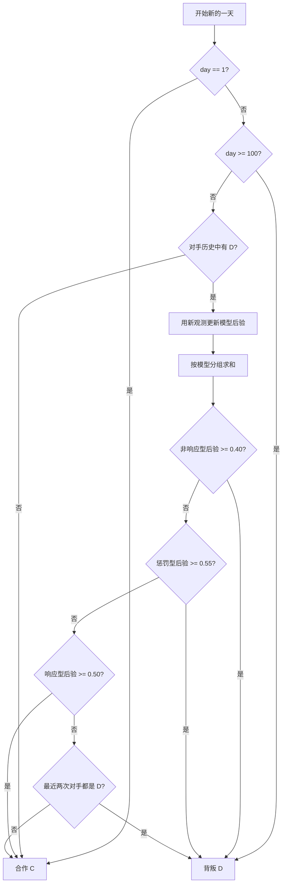

# BayesPlus / Responsive3 C++ 实现与流程图

代码文件：`cpp/bayesplus_responsive3.cpp`

动作约定：

- `0 = C = 合作`
- `1 = D = 背叛`
- `day` 从 1 到 100
- 每场比赛开始前调用一次 `reset()`

编译：

```bash
g++ -std=c++17 -O2 -DRESP_BAYES_DEMO cpp/bayesplus_responsive3.cpp -o demo
./demo
```

---

## 一、Responsive3 参数

| 参数 | 数值 |
|---|---:|
| `G_UNPROVOKED` | 0.55 |
| `G_MUTUAL` | 0.40 |
| `G_RESPONSIVE` | 0.95 |
| `MIN_C` | 5 |
| `MIN_D` | 3 |
| `RESP_GAP` | 0.38 |
| `DEFECT_RATE` | 0.18 |
| `MAX_TESTS` | 2 |
| `COOLDOWN` | 8 |
| 交替检测长度 | 10 |
| 最后一天 | 100，固定 D |

### Responsive3 流程图



### 判定条件

- `pC = dC / nC`
- `pD = dD / nD`
- `enough = nC >= 5 && nD >= 3`
- `responsive = enough && pC <= 0.35 && pD >= 0.65 && (pD-pC) >= 0.38`
- `nonresponsive = enough && (pD-pC) < 0.35 && dRate >= 0.18`
- 和平测试：`tests < 2 && day-last_test >= 8 && nC >=5 && nD >=2 && pC<=0.35 && pD>=0.65 && (pD-pC)>=0.40`

---

## 二、BayesPlus 参数与模型库

BayesPlus 不做主动探测。第 1 天合作；第 100 天固定背叛；在第一次观察到对手 D 之前一直合作。

核心阈值：

| 参数 | 数值 |
|---|---:|
| `NONRESP_THRESHOLD` | 0.40 |
| `PUNITIVE_THRESHOLD` | 0.55 |
| 响应型后验门槛 | 0.50 |
| 最后一天 | 100，固定 D |

### BayesPlus 流程图



### 模型分组

响应型：

- `TFT*`
- `sTFT`
- `GTFT*`
- `Joss*`
- `NoisyTFT*`
- `Pavlov`

惩罚型：

- `Grim*`
- `Grudger*`
- `Mistrust`

其余进入非响应型。

### 主要先验

| 模型 | 先验 |
|---|---:|
| AllC | 8 |
| AllD | 4 |
| TFT | 18 |
| sTFT | 3 |
| Grim | 5 |
| TFT2 | 8 |
| GTFT(.10) | 8 |
| GTFT(.25) | 3 |
| Joss(.05) | 4 |
| Joss(.15) | 2 |
| Random(.2/.5/.8) | 3/3/1 |
| Pavlov | 4 |
| LateD5/10/15/20/25/30/40/50 | 各 3 |
| LateDx k=1..99 | 各 0.16 |
| GTFTx 5/10/20/33/50 | 各 1.5 |
| NoisyTFTx .02/.10/.20 | 各 1.5 |
| TFTdelay1/2/3 | 各 1.5 |
| TFTlastD1/2/3/5/10 | 各 1.0 |
| Grudger1/2/3 | 各 2.0 |
| Mistrust | 2.0 |
| Periodic3/4 | 各 1.0 |
| AlternatorD | 1.0 |
| Tester/Prober | 各 2.0 |
| RemorsefulProber | 1.5 |
| AllC-lastD/EarlyD10/EarlyD25 | 1.0/1.0/0.5 |

---

## 三、接口

```cpp
ipd::Responsive3 r3(12345);
r3.reset();
int action = r3.move(day, my_history, opponent_history);

ipd::BayesPlus bp;
bp.reset();
int action2 = bp.move(day, my_history, opponent_history);
```

`my_history` 和 `opponent_history` 长度均为 `day-1`。
